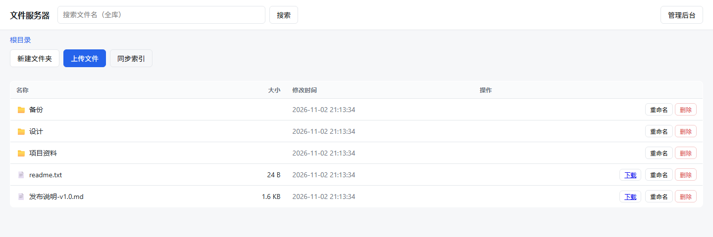

# file-server

[](https://github.com/lvv123/file-server/releases)
[](LICENSE)
[](#快速开始)



个人/小团队内网文件服务器：**单个可执行文件 + 一个 JSON 配置 + 一个数据目录**即可运行，面向百人以内、约 1 TB 存储、单文件约 10 GB 的场景。浏览器打开就是客户端，不需要额外部署前端。

- 分片上传 + 断点续传，浏览器端保持 4 个分片并发（本机实测 10 GiB 续传约 1.3 GB/s）
- 流式下载 + HTTP Range，内存占用与文件大小无关
- SQLite 索引的文件名搜索、全量审计日志、仅本机可访问的管理后台

> [!WARNING]
> 本项目**没有用户认证，也不提供 HTTPS**，默认监听 `0.0.0.0:8080`。
> 它只适合部署在可信内网（家庭 / 办公室局域网）。**请勿暴露到公网**，也不要在不可信网络上运行。
> 若确需公网访问，请在反向代理层自行加上认证与 TLS。

## 快速开始

**方式一：下载预编译版本（Windows x64）**

从 [Releases](https://github.com/lvv123/file-server/releases) 下载 `file-server-1.0.0-win64.zip`，解压后直接运行：

```bat
file-server.exe -c config.json
```

exe 静态链接了 CRT，不依赖 VC++ 运行库，可拷到其他 64 位 Windows 机器直接用。

**方式二：从源码构建**

所有依赖已内置在 `third_party/`（cpp-httplib、nlohmann/json、SQLite amalgamation），构建过程**无需联网、无需包管理器**。前提：CMake ≥ 3.20、C++17 编译器。

**Windows（VS2022）**

```bat
cmake -S . -B build -G "Visual Studio 17 2022" -A x64
cmake --build build --config Release --parallel
build\Release\file-server.exe -c config.json
```

CRT 按静态方式链接，产出的 exe 不依赖 VC++ 运行库，可直接拷到其他 64 位 Windows 机器运行。

**Linux（g++ ≥ 9 / clang ≥ 10）**

```sh
cmake -S . -B build -DCMAKE_BUILD_TYPE=Release
cmake --build build --parallel
./build/file-server -c config.json
```

然后浏览器打开 <http://127.0.0.1:8080/>。首次运行会在 `data_root` 下自动创建 `files/`、`tmp/`、`meta.db`。

## 特性

- **分片上传 + 断点续传**：分片大小由服务端在 `init` 时下发（内置默认 8 MB，随附的 `config.json` 使用 16 MB）；每片一个独立 HTTP 请求，请求体是原始字节而非 `multipart/form-data`；同一会话的多个分片可并发上传。上传中断后按已接收分片续传。
- **流式下载 + HTTP Range**：手动解析 `Range`，正确返回 `206` / `Content-Range` / `Accept-Ranges`；支持闭区间、开区间与后缀区间，多区间请求返回 `416`。全程 64 KB 分块读出，内存占用与文件大小无关。
- **文件 / 目录管理**：列表、新建多级目录、重命名（文件与目录）、删除（文件与空目录）、覆盖上传（先合并到临时文件，再原子替换目标）。
- **全库文件名搜索**：基于 SQLite 索引的模糊匹配（`%q%`），只搜文件名，不做内容全文检索。
- **审计日志**：记录时间、客户端 IP、操作类型、路径、大小、结果、错误信息、耗时、User-Agent；成功与失败都记录，按天数和容量两条策略滚动清理。
- **管理后台**：状态页（磁盘容量、文件数、活跃会话、审计条数）、审计查询、删除；**仅本机可访问**。
- **可靠性**：上传先写 `tmp/`，校验总字节数并 `fsync` 后原子移动到 `files/`；启动时校验 `tmp/` 与 `files/` 位于同一挂载点，不满足直接拒绝启动；进程被强杀后会话与分片仍在，重启可继续上传。

明确不做：秒传 / 去重、限速、用户认证、全文搜索、HTTPS、WebSocket、回收站、CLI / SDK、文件系统实时监听（外部改动需重启或调用 `/api/resync`）。

## 运行

```sh
./file-server -c config.json
```

| 参数 | 说明 |
| --- | --- |
| `-c`, `--config <path>` | 配置文件路径，默认 `config.json` |
| `--check-config` | 只校验配置并初始化数据目录，不启动服务 |
| `-h`, `--help` | 显示帮助 |
| `--version` | 显示版本 |

退出码：`0` 正常退出，`1` 启动失败（配置以外的原因，如端口占用、`tmp/` 与 `files/` 跨挂载点），`2` 配置文件错误。

> **关于 `data_root`**：相对路径是相对于**进程的当前工作目录**，不是配置文件所在目录。以服务方式运行时工作目录通常不是你以为的那个，建议直接写绝对路径，或用 systemd 的 `WorkingDirectory` / 计划任务的「起始于」显式指定。

## 配置

配置文件为 JSON，所有键都可选，缺失的键使用默认值。

```json
{
  "port": 8080,
  "bind_address": "0.0.0.0",
  "data_root": "./data",
  "chunk_size_mb": 16,
  "session_ttl_hours": 24,
  "audit_retention_days": 30,
  "audit_max_size_mb": 512,
  "admin_allow_ips": ["127.0.0.1"]
}
```

| 键 | 默认值 | 说明 |
| --- | --- | --- |
| `port` | `8080` | 监听端口，1–65535 |
| `bind_address` | `"0.0.0.0"` | 监听地址，改成 `127.0.0.1` 则只允许本机访问 |
| `data_root` | `"./data"` | 数据目录，存放 `files/`、`tmp/`、`meta.db` |
| `chunk_size_mb` | `8` | 分片大小，1–1024（随附配置用 16） |
| `session_ttl_hours` | `24` | 上传会话保留时长，超时后分片被清理 |
| `audit_retention_days` | `30` | 审计日志保留天数，`0` 表示不按天数清理 |
| `audit_max_size_mb` | `512` | 审计库容量上限，`0` 表示不按容量清理 |
| `admin_allow_ips` | `["127.0.0.1"]` | 允许访问管理接口的来源 IP |

高级键（同样可选）：`thread_min`(16)、`thread_max`(32)、`thread_max_queue`(64)、`io_timeout_sec`(300)、`max_json_body_bytes`(1048576)、`search_limit_default`(200)、`search_limit_max`(1000)。

规则与限制：

- `tmp/` 与 `files/` 必须位于同一挂载点（同一磁盘卷），否则启动直接失败。这是原子替换的前提。
- 管理接口按 **TCP 对端地址** 判定来源，不信任 `X-Forwarded-For`。经反向代理访问时管理接口会返回 `403`，应把 `admin_allow_ips` 配成代理主机地址。
- 修改配置后需要重启进程生效。

## API

所有接口返回统一信封：

```json
{ "ok": true,  "data": { } }
{ "ok": false, "error": { "code": "NOT_FOUND", "message": "..." } }
```

业务接口无认证，供内网使用；管理接口仅本机可访问。

### 业务接口

| 方法 | 路径 | 说明 |
| --- | --- | --- |
| `GET` | `/api/files?path=/` | 列出目录内容 |
| `GET` | `/api/search?q=&limit=&offset=` | 按文件名搜索 |
| `POST` | `/api/mkdir` | 新建目录，body `{"path":"/a/b"}` |
| `POST` | `/api/rename` | 重命名，body `{"from":"/a","to":"/b"}` |
| `DELETE` | `/api/files?path=/a` | 删除文件或空目录 |
| `GET` | `/api/resync` | 重新扫描 `files/`，让索引与磁盘对齐 |
| `GET` | `/api/download?path=/a/b.bin` | 下载，支持 `Range` |
| `POST` | `/api/upload/init` | 开始上传，body `{"path":"/a/b.bin","total_size":123}` |
| `PUT` | `/api/upload/chunk` | 上传分片，头 `X-Session-Id`、`X-Chunk-Index`，body 为原始字节 |
| `GET` | `/api/upload/session?id=` | 查询会话已接收的分片索引 |
| `POST` | `/api/upload/complete` | 合并分片并落盘，body `{"session_id":"..."}` |

`/api/resync` 是幂等的维护接口：递归遍历 `files/`，把磁盘上新增的条目补进索引、把已消失的条目删掉，返回 `{"scanned","inserted","removed","file_count"}`。页面上的「同步索引」按钮就是它。用 `GET` 是为了让 `curl` 这类不带 body 的客户端也能直接调用（无 body 的 `POST` 会让底层框架等待对端关闭连接）。

### 上传流程

1. `POST /api/upload/init` → 返回 `{"session_id","chunk_size","total_chunks","expires_at"}`
2. 重复 `PUT /api/upload/chunk`，`X-Chunk-Index` 从 `0` 开始，`Content-Length` 必须**精确等于**该片应有的字节数（前 `n-1` 片为 `chunk_size`，最后一片为余数）
3. 中断后 `GET /api/upload/session?id=` 取已接收索引，跳过已完成的分片续传
4. `POST /api/upload/complete` 合并写入目标路径

用 `curl` 走一遍完整流程：

```sh
# 1) 初始化，拿到 session_id 与服务端分配的分片大小
curl -s -X POST http://127.0.0.1:8080/api/upload/init \
  -H 'Content-Type: application/json' \
  -d '{"path":"/demo/big.bin","total_size":41943040}'
# → {"ok":true,"data":{"session_id":"9b2f...","chunk_size":16777216,"total_chunks":3,...}}

# 2) 按 chunk_size 切开，逐片上传（请求体是原始字节，不是 multipart）
split -b 16777216 big.bin chunk-
curl -s -X PUT http://127.0.0.1:8080/api/upload/chunk \
  -H 'X-Session-Id: 9b2f...' -H 'X-Chunk-Index: 0' \
  --data-binary @chunk-aa

# 3) 合并落盘
curl -s -X POST http://127.0.0.1:8080/api/upload/complete \
  -H 'Content-Type: application/json' -d '{"session_id":"9b2f..."}'
# → {"ok":true,"data":{"path":"/demo/big.bin","size":41943040}}
```

分片写入 `tmp/<session_id>/NNNNNNNN.part`（先写唯一命名的临时文件再 `rename`，重传与并发都安全）。完成时按索引顺序流式拼接、校验总字节数与声明一致、`fsync`，最后原子替换目标路径。合并失败会保留会话与分片，可重试。

同一会话的多个分片可以并发上传：服务端对会话持共享锁写分片，只在合并/删除时取排他锁，位图更新用独立短锁串行化。浏览器端默认保持 4 个分片在途。

零字节文件同样支持：`total_size` 填 `0`，服务端返回 `total_chunks: 0`，直接调用 `complete` 即可生成空文件。

### 下载与 Range

```sh
# 整文件
curl -s -o out.bin 'http://127.0.0.1:8080/api/download?path=/demo/big.bin'

# 只看响应头（含 Content-Range / Accept-Ranges）
curl -sI -H 'Range: bytes=0-1023' \
  'http://127.0.0.1:8080/api/download?path=/demo/big.bin'
# HTTP/1.1 206 Partial Content
# Accept-Ranges: bytes
# Content-Range: bytes 0-1023/41943040
# Content-Length: 1024
```

支持 `bytes=0-1023`（闭区间）、`bytes=1048576-`（到文件末尾）、`bytes=-1024`（最后 1024 字节）三种形式。多区间请求、起点越界、区间非法一律返回 `416` 并带 `Content-Range: bytes */<size>`。响应带 `Content-Disposition: attachment`，文件名按 RFC 5987 做 UTF-8 百分号编码。

### 管理接口（仅本机）

| 方法 | 路径 | 说明 |
| --- | --- | --- |
| `GET` | `/admin/status` | 磁盘容量、文件数、活跃会话、审计条数 |
| `GET` | `/admin/audit?limit=&offset=` | 审计记录，`limit` 默认 50、上限 500 |
| `DELETE` | `/admin/files?path=/a` | 删除文件或空目录 |

### 状态码

| 码 | 含义 |
| --- | --- |
| `200` / `206` | 成功 / 部分内容 |
| `400` | 参数缺失或非法、JSON 错误、分片索引越界 |
| `403` | 路径穿越、管理接口非本机 |
| `404` | 文件、目录或会话不存在 |
| `409` | 目标已存在、目录非空、分片不齐 |
| `411` | 缺少 `Content-Length` |
| `413` | 分片大小与声明不符、请求体过大 |
| `416` | `Range` 非法 |
| `500` | 磁盘 IO 失败或未预期错误 |
| `507` | 磁盘空间不足 |

## 部署

Linux 用 systemd：

```ini
[Unit]
Description=file-server
After=network.target

[Service]
Type=simple
WorkingDirectory=/srv/file-server
ExecStart=/srv/file-server/file-server -c /srv/file-server/config.json
Restart=on-failure

[Install]
WantedBy=multi-user.target
```

Windows 用计划任务（项目本身不是 Windows 服务）：

```bat
schtasks /create /tn file-server /tr "\"C:\file-server\file-server.exe\" -c \"C:\file-server\config.json\"" ^
  /sc onstart /ru SYSTEM /rl HIGHEST
```

经 nginx 反向代理时注意两点：`client_max_body_size` 必须不小于 `chunk_size`，且建议 `proxy_request_buffering off`，否则 nginx 会把每个分片先缓冲到自己的磁盘上。

## 数据目录

```
data/
├── files/      # 业务文件，直接映射真实磁盘目录
├── tmp/        # 上传中的分片与会话临时文件（必须与 files/ 同挂载点）
└── meta.db     # SQLite：files 索引、upload_sessions、audit_logs
```

`files/` 下的内容就是用户可见的文件树，可以按需备份或迁移。`meta.db` 中的 `files` 索引在每次启动时按磁盘实际内容校对，**损坏或丢失可以重建**：删掉 `meta.db` 重启，或启动后调用 `GET /api/resync` 即可恢复列表与搜索。

备份时停掉服务后直接复制整个 `data/` 目录即可；只想备份文件内容则复制 `files/`，索引可以靠重扫恢复（但审计日志在 `meta.db` 里，会一起丢失）。

## 测试

单元测试（零第三方依赖的自研断言框架，80 个用例 / 532 条断言）。测试目标默认参与构建，无需额外开关：

```bat
cmake -S . -B build -G "Visual Studio 17 2022" -A x64
cmake --build build --config Debug --parallel
ctest --test-dir build -C Debug --output-on-failure

:: 也可直接运行，支持 --filter <子串> / --list
build\Debug\fs_unit_tests.exe --filter range
```

```sh
# Linux
cmake -S . -B build -DCMAKE_BUILD_TYPE=Debug
cmake --build build --parallel
ctest --test-dir build --output-on-failure
```

接口 / 集成测试（会自行启动真实服务进程，使用临时数据目录，不碰你的 `data/`）：

```powershell
powershell -NoProfile -ExecutionPolicy Bypass -File tests/api/run_api_tests.ps1
```

常用参数：`-Only <子串>` 只跑匹配的用例，`-KeepData` 保留临时数据目录，`-Port` 指定端口（默认自动选空闲端口），`-DiskFullDir <盘符>\` 打开磁盘写满用例。当前结果：64 项通过、1 项跳过（磁盘满，需要一块接近写满的卷），覆盖路径穿越矩阵、50 并发审计写入、管理接口非本机 403、协议边界等。

大文件验收（写入约 2 倍于文件大小的磁盘空间，默认 10 GiB，耗时数分钟）：

```powershell
powershell -NoProfile -ExecutionPolicy Bypass -File tests/api/acceptance_large.ps1
# 快速版本
powershell -NoProfile -ExecutionPolicy Bypass -File tests/api/acceptance_large.ps1 -SizeMB 64
```

该脚本完整走一遍「上传 → 强杀进程 → 重启 → 查询会话 → 续传 → 合并 → 校验文件内容」，对应验收标准第 1 条。

## 开发

```
src/            服务端源码（C++17）
  main.cpp        入口、启动序列、维护线程
  server.cpp      路由注册
  handler_*.cpp   各接口实现
  repo_*.cpp      SQLite 数据访问
  upload.cpp      分片落盘与合并
  download.cpp    流式下载与 Range
  paths.cpp       路径规范化与越界防护
web/            内嵌前端（原生 HTML/CSS/JS，无构建步骤）
tests/unit/     单元测试
tests/api/      接口测试脚本（PowerShell）
third_party/    依赖源码
tools/          gen_assets.py：把 web/ 转成 C++ 字符串
```

前端资源通过 `tools/gen_assets.py` 转换为 `src/static_assets.cpp` 编入二进制。修改 `web/` 后重新生成：

```sh
python tools/gen_assets.py
```

或配置 `-DFS_REGENERATE_ASSETS=ON` 在构建时自动执行（需要 Python）。

架构约束：每个线程使用独立的 SQLite 连接并强制 `WAL`、`busy_timeout`、`synchronous=NORMAL`；所有用户路径经规范化与根目录包含性检查；分片与下载全程流式，不把完整文件或大分片读入内存。

浏览器要求：任何 2018 年之后的现代浏览器（用到 `fetch`、`localStorage`、`async/await`），不兼容 IE。

## 第三方组件

| 组件 | 版本 | 许可 |
| --- | --- | --- |
| [cpp-httplib](https://github.com/yhirose/cpp-httplib) | 0.18.3 | MIT |
| [nlohmann/json](https://github.com/nlohmann/json) | 3.11.3 | MIT |
| [SQLite](https://sqlite.org/) | 3.50.4 amalgamation | Public Domain |

三者均以源码形式放在 `third_party/` 并静态编入可执行文件，各自的许可证条款随源码保留。

## 许可证

[MIT](LICENSE)
